# Скрипты ChromeScripts для Firefox
### Тут в основном порты кнопок из умирающего **Custom Buttons**.

### Все скрипты протестированы на загрузчике от [MrOtherGuy](https://github.com/MrOtherGuy/fx-autoconfig).
#### Скрипты созданы при помощи **ИИ**.

---

## Менеджер скриптов `rebuild_userChrome.uc.js`
Кнопка с меню для управления пользовательскими `.uc.js`, `.uc.mjs` и `.sys.mjs` скриптами (`rebuild_userChrome.uc.js` исключён из списка). Разработано специально для загрузчика от [MrOtherGuy](https://github.com/MrOtherGuy/fx-autoconfig).
* [Ссылка на страницу](userChromeJS/rebuild_userChrome.uc.js)
* [Ссылка на raw](https://raw.githubusercontent.com/KotDaVinci-1/FirefoxChromeScripts/main/userChromeJS/rebuild_userChrome.uc.js)
### Основные возможности:
* **Управление скриптами:** Включение и отключение скриптов из меню кнопки (изменения применяются после перезапуска браузера).
* **Динамическое обновление списка:** Меню и метаданные формируются «на лету» при каждом открытии. В отличие от встроенного меню загрузчика, новые файлы или изменения в описаниях скриптов появляются в списке сразу, без необходимости перезапускать браузер.
* **Интеграция с редактором:** Позволяет назначить любой сторонний текстовый редактор (Sublime Text, AkelPad и др.) для быстрого редактирования кода скриптов.
* **Динамические пути:** Менеджер автоматически находит папку со скриптами на основе конфигурации `chrome.manifest`.
* **Быстрые действия:** В меню встроены кнопки для открытия папки со скриптами, настройки текстового редактора и быстрого перезапуска браузера.

	
<h3>Поддержка метаданных и Управление</h3>

### Поддержка метаданных (блок `==UserScript==`)
Скрипт умеет читать заголовочную информацию из файлов и делает меню более информативным. Поддерживаются следующие теги:
* **`@name`** — заменяет имя файла (например, `script_button.uc.js`) на название в меню.
* **`@description`** — выводит текст описания во всплывающую подсказку (tooltip) при наведении.
* **`@homepage`** или **`@homepageURL`** — выводит ссылку в подсказку и позволяет перейти на страницу скрипта по клику.

### Управление (клики по пунктам меню):
* **ЛКМ** — Включить / Отключить скрипт.
* **СКМ** — Открыть домашнюю страницу скрипта в новой вкладке.
* **ПКМ** — Открыть файл скрипта в текстовом редакторе (при первом запуске предложит указать путь к редактору).
 

    
<b>Скриншоты</b>

 
    
Меню и подсказка:

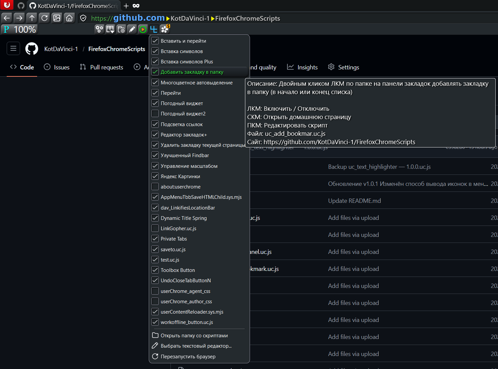

Выбор текстового редактора:

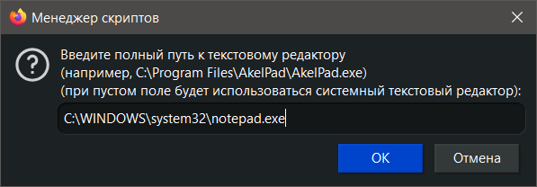
  

---

## Управление масштабом `uc_zoom_control.uc.js`
Кнопка для управления масштабом страницы.
* [Ссылка на страницу](userChromeJS/uc_zoom_control.uc.js)
* [Ссылка на raw](https://raw.githubusercontent.com/KotDaVinci-1/FirefoxChromeScripts/main/userChromeJS/uc_zoom_control.uc.js)

	
<h3>Управление</h3>

- **ЛКМ** — 100%.
- **Прокрутка колёсиком** — изменить масштаб.
- **СКМ** — переключить режим масштабирования (страница/текст).
- **ПКМ** — сменить оформление кнопки (4 варианта).
Дополнительно поддерживает отображение текущего масштаба (опционально).
 

    
<b>Скринышоты с примерами режимов работы кнопки</b>

 
    
**P**/**PAGE** - масштаб всей страницы. **T**/**TEXT** - масштаб текста.

Тёмная тема:

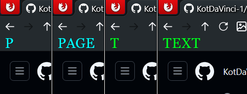
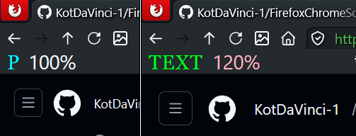
  

Светлая тема:

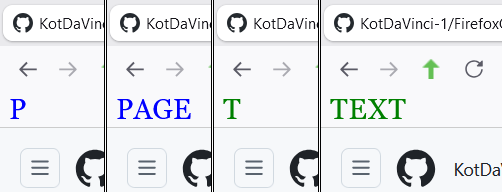
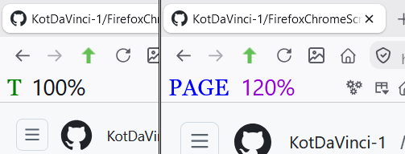
  

Кастомные кнопки:

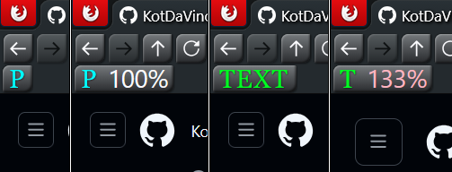
  

---

## Вставить и перейти `uc_paste_and_go.uc.js`
Кнопка для открытия содержимого буфера обмена в новой вкладке.
* [Ссылка на страницу](userChromeJS/uc_paste_and_go.uc.js)
* [Ссылка на raw](https://raw.githubusercontent.com/KotDaVinci-1/FirefoxChromeScripts/main/userChromeJS/uc_paste_and_go.uc.js)

	
<h3>Управление и Особенности</h3>

    
### Управление:
- **ЛКМ по кнопке** — открыть содержимое буфера обмена в новой вкладке.
- **Ctrl+Shift+V** — выполнить то же действие (можно отключить).
- **СКМ по адресной строке** — выполнить то же действие (можно отключить).

### Особенности:
- Горячую клавишу и клик СКМ по адресной строке можно отключить в настройках скрипта.
- Для горячей клавиши поддерживается список доменов-исключений.
- Содержит патч совместимости с `dav_LinkifiesLocationBar.uc.js`.
 

---

## Яндекс Картинки `uc_yandex_images.uc.js`
Пример кнопки-закладки для открытия заранее заданного адреса.
* [Ссылка на страницу](userChromeJS/uc_yandex_images.uc.js)
* [Ссылка на raw](https://raw.githubusercontent.com/KotDaVinci-1/FirefoxChromeScripts/main/userChromeJS/uc_yandex_images.uc.js)

	
<h3>Управление и Особенности</h3>

    
### Управление:
- **ЛКМ** — открыть ссылку в новой активной вкладке.
- **СКМ** — открыть ссылку в новой фоновой вкладке.

### Особенности:
- Скрипт можно использовать как шаблон для создания собственных кнопок-закладок.
- Для изменения назначения достаточно заменить `URL`, `label`, `ICON_URL` (можно просто использовать ссылку на favicon сайта), `ID` и `@name`.
- Количество таких кнопок не ограничено — достаточно создать копию скрипта с новыми параметрами.
 

---

## Перейти `uc_go_button.uc.js`
Постоянно доступный аналог кнопки **«Перейти»** из адресной строки.
* [Ссылка на страницу](userChromeJS/uc_go_button.uc.js)
* [Ссылка на raw](https://raw.githubusercontent.com/KotDaVinci-1/FirefoxChromeScripts/main/userChromeJS/uc_go_button.uc.js)

	
<h3>Управление и Особенности</h3>

### Управление:
- **ЛКМ** — выполнить переход по адресу, указанному в адресной строке.
### Особенности:
- Может использоваться для повторного перехода по текущему адресу, например к якорю (`#...`) на странице.
 

---

## Подсветка ссылок `uc_link_highlighter.uc.js`
Подсвечивает ссылки в зависимости от их типа.
* [Ссылка на страницу](userChromeJS/uc_link_highlighter.uc.js)
* [Ссылка на raw](https://raw.githubusercontent.com/KotDaVinci-1/FirefoxChromeScripts/main/userChromeJS/uc_link_highlighter.uc.js)

	
<h3>Управление и Особенности</h3>

### Управление:
- **ЛКМ** — включить/выключить подсветку.

### Особенности:
- **Красный** — внешние ссылки.
- **Синий** — ссылки внутри сайта.
- **Зелёный** — ссылки внутри страницы.
- Подсветка автоматически применяется к открываемым страницам, пока кнопка включена.
 

    
<b>Скриншоты с примером работы кнопки</b>

 

Кнопка отключена:

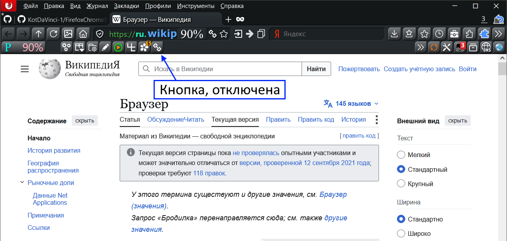
  

Кнопка включена:

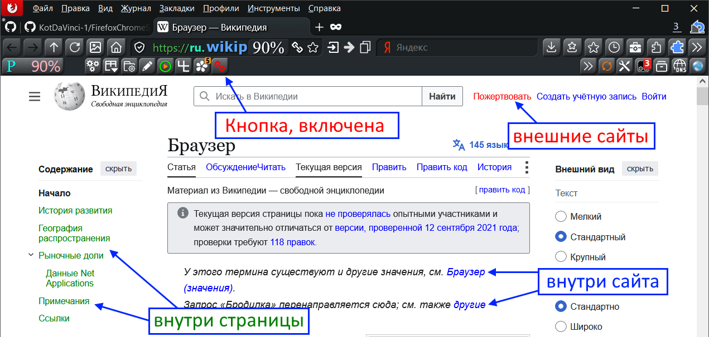
  

---

## Улучшенный Findbar `uc_findbar_func.uc.js`
Добавляет в панель поиска дополнительные функции и улучшает её поведение.
* [Ссылка на страницу](userChromeJS/uc_findbar_func.uc.js)
* [Ссылка на raw](https://raw.githubusercontent.com/KotDaVinci-1/FirefoxChromeScripts/main/userChromeJS/uc_findbar_func.uc.js)

	
<h3>Управление и Особенности</h3>

### Управление:
- **Колёсико над панелью поиска** — переход к следующему/предыдущему совпадению.
- **ЛКМ по кнопке** — вставить текст из буфера обмена.
- **СКМ по кнопке** — использовать выделенный на странице текст.
- **ПКМ по кнопке** — очистить поле поиска.

### Особенности:
- Добавляет в панель поиска кнопку для работы с поисковым запросом.
- Общий Файндбар для всех вкладок (опционально, настройка в скрипте).
- Повторное нажатие **Ctrl+F** закрывает панель поиска (опционально, настройка в скрипте).
- Кнопка закрытия Файндбара перенесена в левую часть панели.
 

    
<b>Скриншоты</b>

 

Кнопки:

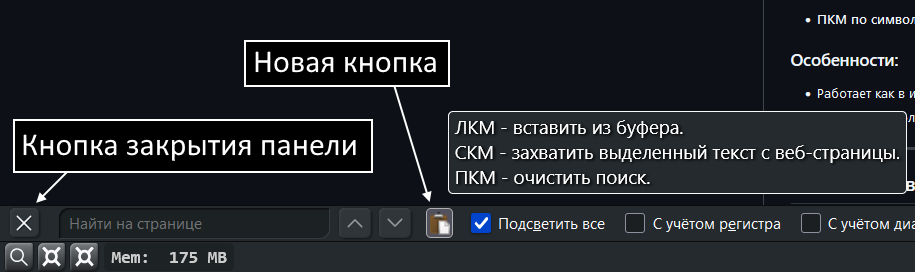
  

Переход к следующему/предыдущему совпадению прокруткой колёсиком в любом месте Файндбара:

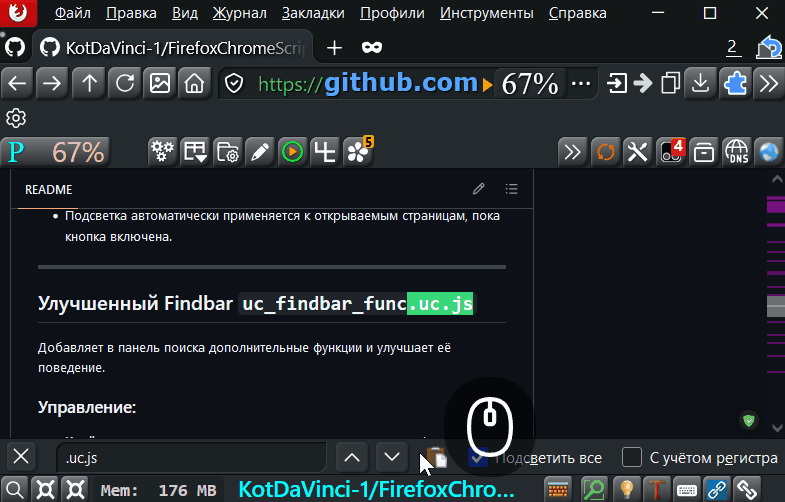
  

---

## Удалить закладку текущей страницы `uc_context_remove_bookmark.uc.js`
Добавляет в контекстное меню страницы пункт для удаления закладок текущей страницы.
* [Ссылка на страницу](userChromeJS/uc_context_remove_bookmark.uc.js)
* [Ссылка на raw](https://raw.githubusercontent.com/KotDaVinci-1/FirefoxChromeScripts/main/userChromeJS/uc_context_remove_bookmark.uc.js)

	
<h3>Управление и Особенности</h3>

### Управление:
- **ПКМ по странице → «Удалить эту страницу из закладок»** — удалить все закладки, ведущие на текущую страницу.

### Особенности:

- Пункт меню отображается только для страниц, уже добавленных в закладки.
- Расположение пункта меню настраивается в скрипте.
- После удаления отображается уведомление со списком папок, из которых были удалены закладки.
 

    
<b>Скриншоты</b>

 

После панели навигации:

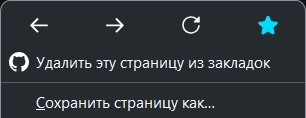
  

До панели навигации:

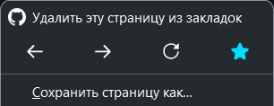
  

Внутри панели навигации:

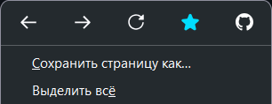
  

Уведомление:

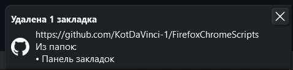
  

---

## Редактор закладок+ `uc_resizableBookmarkPanel.uc.js`
Улучшает панель редактирования закладок.
* [Ссылка на страницу](userChromeJS/uc_resizableBookmarkPanel.uc.js)
* [Ссылка на raw](https://raw.githubusercontent.com/KotDaVinci-1/FirefoxChromeScripts/main/userChromeJS/uc_resizableBookmarkPanel.uc.js)

	
<h3>Возможности</h3>

- Изменяемый размер панели с сохранением между запусками.
- Автоматическое раскрытие дерева папок.
- Позволяет редактировать адрес закладки.
- Добавляет в панель поддержку ключевых слов для закладок.
 

    
<b>Скриншоты</b>

 

Новая панель редактирования закладок:

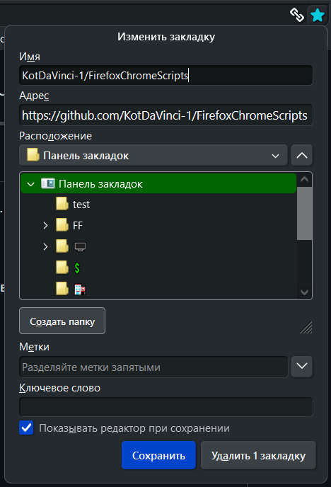

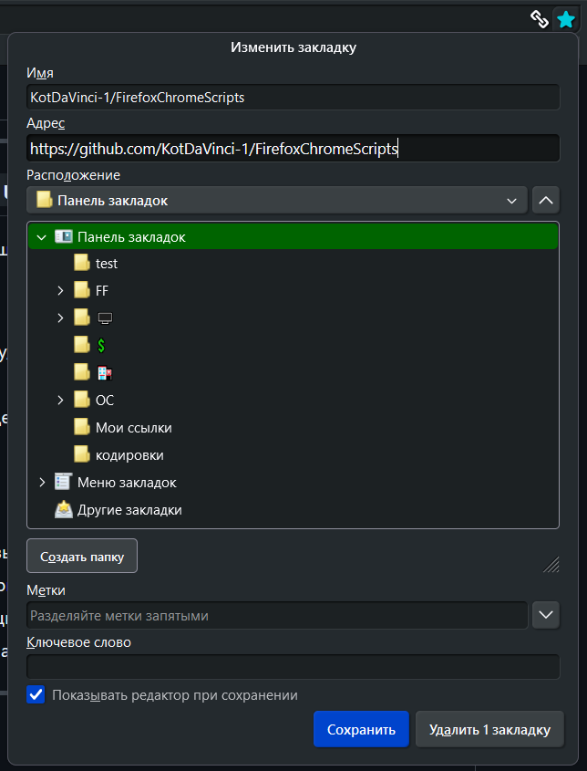
  

Старая панель редактирования закладок (для наглядности):

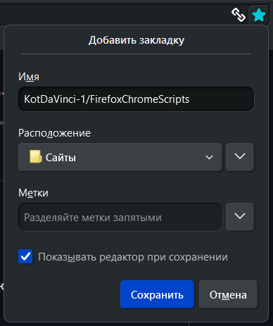
  

---

## Вставка символов `uc_insert_symbols.uc.js`
Кнопка с меню специальных символов и эмодзи.
* [Ссылка на страницу](userChromeJS/uc_insert_symbols.uc.js)
* [Ссылка на raw](https://raw.githubusercontent.com/KotDaVinci-1/FirefoxChromeScripts/main/userChromeJS/uc_insert_symbols.uc.js)

	
<h3>Управление и Особенности</h3>

### Управление:
- **ЛКМ по кнопке** — открыть меню символов.
- **СКМ по кнопке** — открыть Таблицу символов Windows.
- **ЛКМ по символу** — вставить символ.
- **ПКМ по символу** — вставить символ, не закрывая меню.

### Особенности:
- Работает как в интерфейсе Firefox, так и на веб-страницах.
- Набор и расположение символов легко настраиваются в скрипте массиве `columns`
 

    
<b>Скриншоты</b>
 

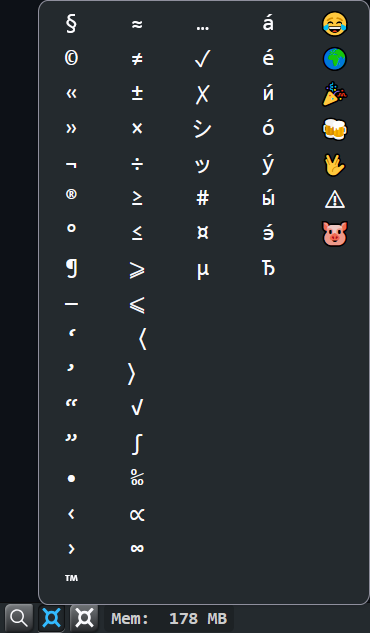
  

---

## Вставка символов Plus `uc_insert_symbols_plus.uc.js`
Расширенная версия скрипта **«Вставка символов»**. Помимо вставки отдельных символов позволяет вставлять готовые текстовые шаблоны и использовать содержимое буфера обмена.
* [Ссылка на страницу](userChromeJS/uc_insert_symbols_plus.uc.js)
* [Ссылка на raw](https://raw.githubusercontent.com/KotDaVinci-1/FirefoxChromeScripts/main/userChromeJS/uc_insert_symbols_plus.uc.js)

	
<h3>Управление и Особенности</h3>

### Особенности:
- Все возможности скрипта **«Вставка символов»**.
- Вставка готовых фраз и многострочных шаблонов.
- Поддержка макроса `{CLIPBOARD}` для вставки содержимого буфера обмена в шаблон.
- Отдельные подписи (`disp`) и вставляемый текст (`ins`) для пунктов меню.
- Просмотр полного текста шаблона во всплывающей подсказке.

### Управление:
- **ЛКМ по кнопке** — открыть меню.
- **СКМ по кнопке** — открыть «Таблицу символов» Windows.
- **ЛКМ по пункту** — вставить текст.
- **ПКМ по пункту** — вставить текст без закрытия меню.
 

    
<b>Скриншоты</b>
 

В подсказку выводится то, что будет вставлено при клике.

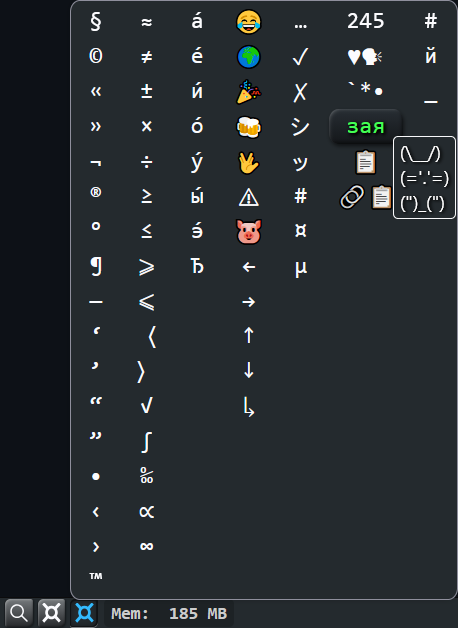
  

---

## Многоцветное автовыделение `uc_text_highlighter.uc.js`
Скрипт для одновременной подсветки произвольных слов и фраз на веб-страницах несколькими цветами.
* [Ссылка на страницу](userChromeJS/uc_text_highlighter.uc.js)
* [Ссылка на raw](https://raw.githubusercontent.com/KotDaVinci-1/FirefoxChromeScripts/main/userChromeJS/uc_text_highlighter.uc.js)

Использует современный **CSS Custom Highlight API**: подсветка накладывается поверх уже отрисованного текста без изменения DOM. Благодаря этому сохраняется работоспособность ссылок и форматирования, а поиск корректно находит фразы, даже если они пересекают разные HTML-теги.

	
<h3>Основные возможности и Управление</h3>

### Основные возможности
- **Многопоточность:** несколько независимых слотов поиска, работающих одновременно, каждый со своим цветом.
- **Поддержка Unicode:** корректная работа с кириллицей, латиницей, эмодзи и любыми другими символами.
- **Гибкость:** настраиваемая чувствительность к регистру (Aa) и диакритическим знакам (ä).
- **Визуализация:** цветные маркеры совпадений рядом с полосой прокрутки (аналогично стандартному `Ctrl+F`, но для всех слотов сразу).
- **Умное обновление:** подсветка автоматически обновляется при переключении вкладок, дозагрузке страниц или изменении искомых слов.
- **Надежность:** все настройки и тексты слотов сохраняются в `about:config`.

### Управление (Кнопка на панели)
Всё управление осуществляется через одну кнопку. Во время работы подсветки её иконка плавно меняет цвета.
На бейдже кнопки всегда отображается номер и цвет **активного слота**.

- **ЛКМ:** Включить / выключить подсветку на всех вкладках. *(После запуска браузера подсветка всегда выключена).*
- **СКМ:** Записать выделенный на странице текст в активный слот (заменив старый).
- **Прокрутка колёсиком:** Переключить активный слот (работает при наведении на кнопку или её меню).
- **ПКМ:** Открыть меню управления.

### Меню управления
Открывается по ПКМ на кнопке и позволяет:
- **ЛКМ по слоту:** открыть окно ручного ввода/редактирования текста.
- **СКМ по слоту:** скопировать текст слота в буфер обмена.
- **Чекбоксы:** быстро переключать учет регистра и диакритики.
- **Очистка:** удалить текст из всех слотов одной кнопкой (пустые слоты в поиске не участвуют).

### Настройки и ограничения
- Поиск является литеральным (регулярные выражения не поддерживаются).
- Количество слотов и их цвета задаются внутри кода скрипта (в массиве `COLORS`). 
- Максимальная длина текста для одного слота по умолчанию — **50 символов** (можно изменить в коде скрипта). При превышении лимита выводится уведомление.
 

    
<b>Скриншоты</b>
 

Пример подсветки:

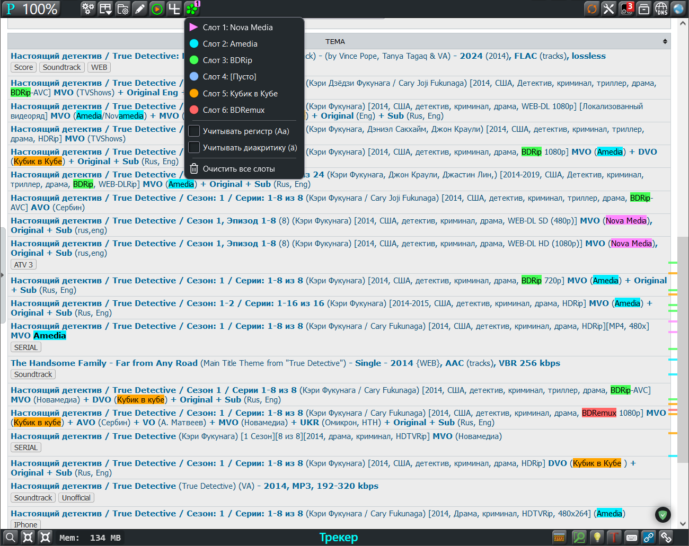
  

Работа диакритики и регистра:

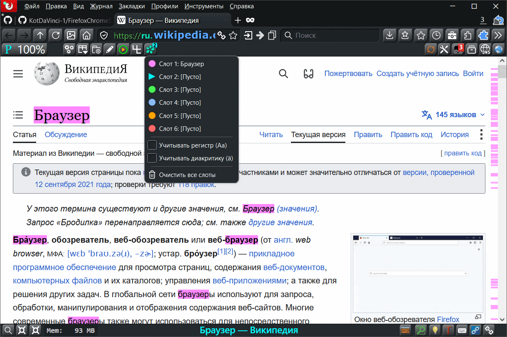
  

---

## Добавить закладку в папку `uc_add_bookmar.uc.js`
Добавляет текущую страницу в выбранную папку на панели закладок.
* [Ссылка на страницу](userChromeJS/uc_add_bookmar.uc.js)
* [Ссылка на raw](https://raw.githubusercontent.com/KotDaVinci-1/FirefoxChromeScripts/main/userChromeJS/uc_add_bookmar.uc.js)

	
<h3>Управление и Особенности</h3>

### Управление:

- **Двойной ЛКМ по папке на панели закладок** — добавить текущую страницу в эту папку.

### Особенности:

- Закладка может добавляться в начало или конец папки (настраивается в скрипте).
- После добавления отображается краткое уведомление.
  

---

## Инфо-пробел `uc_dynamic_spring.uc.js`

Модульный UI-контейнер для панели инструментов Firefox. Благодаря гибкой конфигурации скрипт полностью адаптируется: может работать как компактный блок с системными метриками и погодой, так и как классический расширяющийся пробел с заголовком активной вкладки. Все элементы опциональны.
* [Ссылка на страницу](userChromeJS/uc_dynamic_spring.uc.js)
* [Ссылка на raw](https://raw.githubusercontent.com/KotDaVinci-1/FirefoxChromeScripts/main/userChromeJS/uc_dynamic_spring.uc.js)

	
<h3>Возможности (Модули) и Конфигурация</h3>

### Возможности (Модули)
Все модули можно гибко настроить, отключить или разместить слева/справа от центрального пробела через блок `CONFIG` в начале скрипта.

*   **BASIS (Основа):** Три режима работы — от простого контейнера с виджетами до полноценного расширяющегося пробела с заголовком активной страницы по центру.
*   **Метрики ресурсов (MEMORY, CPU, GFX):** Отслеживание потребления оперативной памяти и процессорного времени активной вкладки, общей нагрузки на графическую подсистему браузера.
*   **Дата и Праздники (DATEW & POVOD):** Вывод текущей даты, в подсказке показывает праздники на сегодня и завтра (или ближайший праздник).
*   **Погода (WEATHER & WICONS):** Отображение температуры и нативных иконок погоды Firefox.
### Конфигурация
Настройка осуществляется правкой объекта `CONFIG` внутри самого скрипта. Вы можете назначить модулям значения `1` (слева), `2` (справа) или `0` (отключить).
### Настройка виджета погоды
Данные для погодного модуля берутся из внутренних систем Firefox. Изначально город определяется автоматически и всё должно работать «из коробки». 
Для какого конкретно города браузер получает прогноз можно посмотреть во всплывающей подсказке виджета. 
Если вы не путешествуете вместе с компьютером, город лучше задать вручную (автоопределение города может периодически ошибаться).

<b>Настройка и решение проблем с погодой</b>
 

Для изменения города необходимо воспользоваться стандартной новой вкладкой браузера:

0. **Включите стандартную новую вкладку:** Если у вас установлено расширение, заменяющее стандартную новую вкладку, временно отключите его. Перейдите в настройки `about:preferences#home` (вкладка *«Домашняя страница и запуск»*) и в разделе *«Домашняя страница»*, в пункте *«Новые вкладки»* выберите **Домашняя страница Firefox (по умолчанию)**.
1. **Измените локацию:** Откройте новую вкладку (`about:newtab`), найдите виджет погоды (обычно в правом верхнем углу). Нажмите на `•••` на виджете ➔ *«Изменить местоположение»* и задайте нужный город вручную.
2. **Что делать, если виджета нет на странице `about:newtab`:**
   * Перейдите в настройки `about:preferences#home` (вкладка *«Домашняя страница и запуск»*), в разделе *«Домашняя страница Firefox»* включить *«Погода»*.
   * **Если переключатель *«Погода»* отсутствует или виджет не появился:** 
      * Откройте `about:config` и вбейте в поиск `weather`. Убедитесь, что все параметры находятся в значении *«по умолчанию»*. 
      * Параметр `browser.newtabpage.activity-stream.system.showWeather` должен быть в положении `true`.
      * **Если виджет по-прежнему отсутствует:** Переведите параметр `browser.newtabpage.activity-stream.nova.enabled` в положение `false`.
      * **Если виджет по-прежнему отсутствует:** 🤷 искать способ призыва виджета самостоятельно.

 

<b>Скриншоты</b>

 

Режим "Расширяющийся пробел", заголовок страницы включён, все виджеты включены:
 

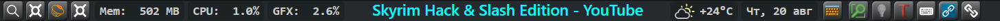
---
 

Режим "Только виджеты", включены виджет погоды без иконки и виджет даты, у виджета даты подсказка с праздниками:
 

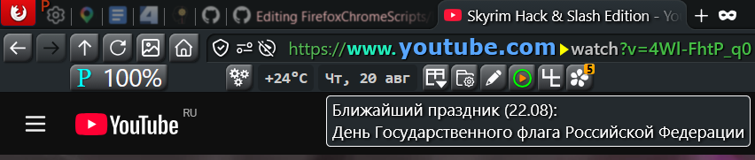

 

---

 ## Погода `uc_weather_widget.uc.js`

Виджет текущей температуры и прогноза погоды на панели браузера.

* [Ссылка на страницу](userChromeJS/uc_weather_widget.uc.js)
* [Ссылка на raw](https://raw.githubusercontent.com/KotDaVinci-1/FirefoxChromeScripts/main/userChromeJS/uc_weather_widget.uc.js)

	
<h3>Возможности и Конфигурация</h3>

### Управление:

- **ЛКМ по виджету** — открыть прогноз погоды в новой вкладке.

- **ПКМ по виджету** — открыть меню настроек.

### Возможности:

- Отображает текущую температуру и погодную иконку.

- Во всплывающей подсказке показывает город, диапазон температур на сегодня, почасовой прогноз и краткая сводка о неблагоприятных погодных условиях в ближайшие дни.
- Автоматически обновляет данные о погоде.
- Поддерживает настройку стиля иконок, цвета текста, фона и размера шрифта.
- Автоматически подстраивается под светлую и тёмную тему Firefox; поддерживает принудительную тёмную тему, жирный шрифт, авторазмеры и отключение иконок.
- В контекстном меню доступна смена внешнего вида без редактирования скрипта.

### Настройка города:

Данные о погоде берутся из внутренних систем Firefox. Изначально город определяется автоматически, поэтому всё должно работать «из коробки».

Для какого конкретно города браузер получает прогноз можно посмотреть во всплывающей подсказке виджета.

Если вы не путешествуете вместе с компьютером, город лучше задать вручную (автоопределение города может периодически ошибаться).

<b>гайд по погодному виджету Firefox</b>
 

Для изменения города необходимо воспользоваться стандартной новой вкладкой браузера:

0. **Включите стандартную новую вкладку:** Если у вас установлено расширение, заменяющее стандартную новую вкладку, временно отключите его. Перейдите в настройки `about:preferences#home` (вкладка *«Домашняя страница и запуск»*) и в разделе *«Домашняя страница»*, в пункте *«Новые вкладки»* выберите **Домашняя страница Firefox (по умолчанию)**.
1. **Измените локацию:** Откройте новую вкладку (`about:newtab`), найдите виджет погоды (обычно в правом верхнем углу). Нажмите на `•••` на виджете ➔ *«Изменить местоположение»* и задайте нужный город вручную.
2. **Что делать, если виджета нет на странице `about:newtab`:**
   * Перейдите в настройки `about:preferences#home` (вкладка *«Домашняя страница и запуск»*), в разделе *«Домашняя страница Firefox»* включить *«Погода»*.
   * **Если переключатель *«Погода»* отсутствует или виджет не появился:** 
      * Откройте `about:config` и вбейте в поиск `weather`. Убедитесь, что все параметры находятся в значении *«по умолчанию»*. 
      * Параметр `browser.newtabpage.activity-stream.system.showWeather` должен быть в положении `true`.
      * **Если виджет по-прежнему отсутствует:** Переведите параметр `browser.newtabpage.activity-stream.nova.enabled` в положение `false`.
      * **Если виджет по-прежнему отсутствует:** 🤷 искать способ призыва виджета самостоятельно.

 

    
<b>Скриншоты</b>
 

Всплывающие подсказки:

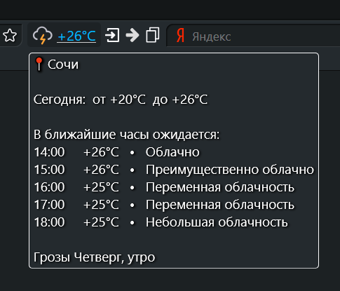

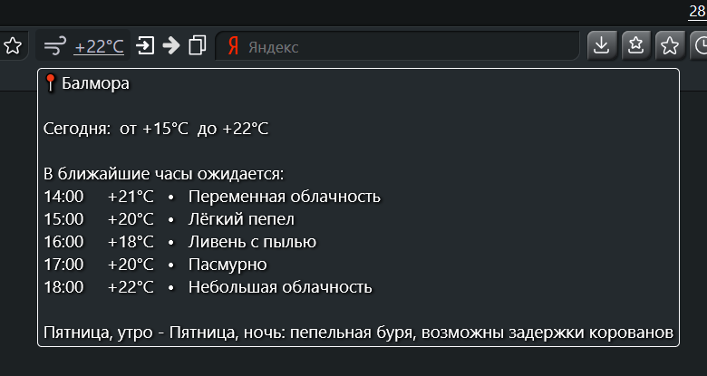
  

Стили иконок, тёмная тема:

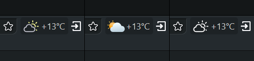

Стили иконок, светлая тема:

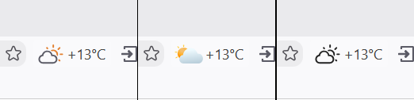

Без иконки:

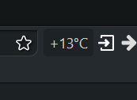
  

Цвет текста в зависимости от погоды, тёмная тема:

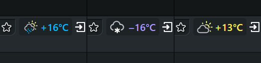

Цвет текста в зависимости от погоды, светлая тема:

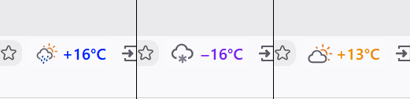
  

Цвет фона в зависимости от погоды, тёмная тема:

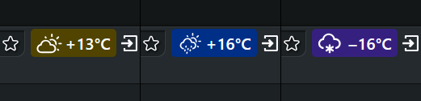

Цвет фона в зависимости от погоды, светлая тема:

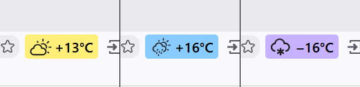
  

Режим "Авторазмеры":

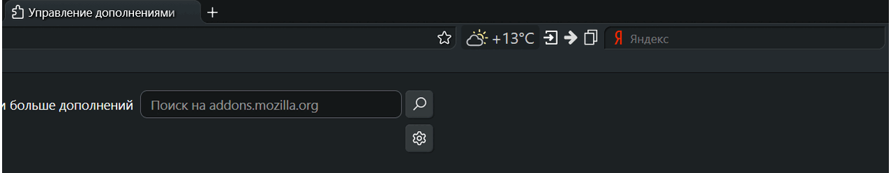
  

Режим "Уменьшенная иконка" (для узких панелей):

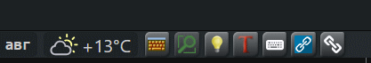
  

 

---

## Privileged CSS Loader `config.js`
Скрипт-загрузчик для внедрения пользовательских стилей на уровне ядра браузера. 
В отличие от стандартных `userChrome.css` и `userContent.css`, этот загрузчик работает через `nsIStyleSheetService` и позволяет регистрировать CSS-файлы с заданным уровнем приоритета (Agent и Author). 
Это дает полный контроль над CSS-каскадом и позволяет применять кастомные стили даже в изолированных системных окнах, таких как Инструменты разработчика (Browser Toolbox) и всплывающие подсказки (tooltip).
* [Ссылка на страницу](userChromeJS/config.js)
* [Ссылка на raw](https://raw.githubusercontent.com/KotDaVinci-1/FirefoxChromeScripts/main/userChromeJS/config.js)

<h3>Описание файлов стилей. Иерархия приоритетов</h3>

### Описание файлов стилей
#### **`userChromeAuthor.css`** (`AUTHOR_SHEET` - продвинутый вариант `USER_SHEET`)
Предназначен для кастомизации интерфейса браузера, включая недоступные для стандартного userChrome.css (уровень `USER_SHEET`) места, такие как Инструменты разработчика браузера (Browser Toolbox) и всплывающие подсказки (tooltip). А также для кастомизации веб-страниц и работы с современными стандартами CSS.
* **Полная поддержка спецификаций**: Единственный уровень, на котором движок рендеринга корректно парсит псевдоэлементы **`::selection`** и **`::highlight`**.
* **Поддержка фолбэков**: Использование **`@layer site_fallback { ... }`** позволяет задавать стили, которые применяются глобально, но автоматически уступают место собственным стилям **веб-сайтов**.
#### **`userChromeAgent.css`** (`AGENT_SHEET` — глубокая кастомизация интерфейса)
Предназначен для точечного вмешательства во внутренний интерфейс браузера.
* **Абсолютный приоритет**: Стили с тегом `!important` на этом уровне имеют высшую силу в каскаде Gecko/Stylo и перебивают любые другие правила (включая системные стили браузера и `USER_SHEET` c `!important`).
* **Базовый дефолт**: Стили без `!important` работают как самый низкий уровень приоритета, задавая дефолтное оформление для компонентов до применения любых других правил.  

### Иерархия приоритетов (CSS Cascade)
#### Чтобы понимать, почему один стиль перебивает другой, вот официальный порядок приоритетов рендеринга Firefox (от самого слабого к самому сильному):
 1. `AGENT_SHEET` (без `!important`) — базовые дефолты браузера.
 2. `USER_SHEET` (без `!important`) — права `userChrome.css` и `userContent.css`.
 3. `AUTHOR_SHEET` (без `!important`, с `@layer` внутри) — применяется везде, но уступает **любым** собственным стилям сайтов.
 4. `AUTHOR_SHEET` (без `!important`) — применяется везде, конкурирует на равных с обычными стилями сайтов, перебивает стили браузера.
 5. `AUTHOR_SHEET` (с `!important`) — перебивает обычные стили сайтов и браузера.
 6. `USER_SHEET` (с `!important`) — перебивает стили сайтов и `AUTHOR_SHEET` (защита доступности), права `userChrome.css` и `userContent.css`.
 7. `AGENT_SHEET` (с `!important`) — абсолютный приоритет (системный хардкод, перебивает всё).

* #### примечание о `@layer`:
  * Использование `@layer` в `AUTHOR_SHEET` понижает приоритет стиля только относительно других стилей **веб-сайта**. Он по-прежнему остается сильнее базовых стилей браузера, стилей `AGENT_SHEET` без `!important` и стилей пользователя `USER_SHEET` без `!important`.

<h3>Установка</h3>

 1. **Добавьте загрузчик в папку браузера**
* Поместите файл `config.js` из этого репозитория в корневую директорию Firefox (туда, где находится исполнительный файл `firefox.exe`, а не в папку профиля).
    * Если в папке вашего браузера уже существует свой файл `config.js` (например, от других скриптов или загрузчиков), не заменяйте его! Откройте существующий файл в любом текстовом редакторе и просто скопируйте код из скачанного `config.js` в самый конец.
    * Первая строка в `config.js` не должна содержать полезный код.

 2. **Добавьте стили в профиль**
 * Создайте файлы `userChromeAgent.css` и `userChromeAuthor.css` в папке `chrome` внутри вашего текущего профиля Firefox.

 3. **Перезапустите Firefox**
 * При следующем запуске браузер автоматически подхватит скрипт из корневой папки и применит стили на соответствующих уровнях каскада.

<b>

